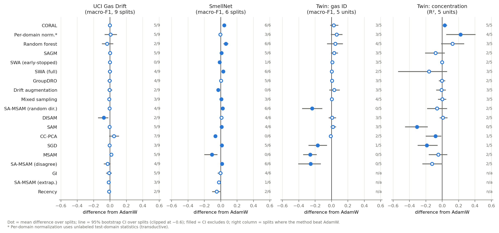
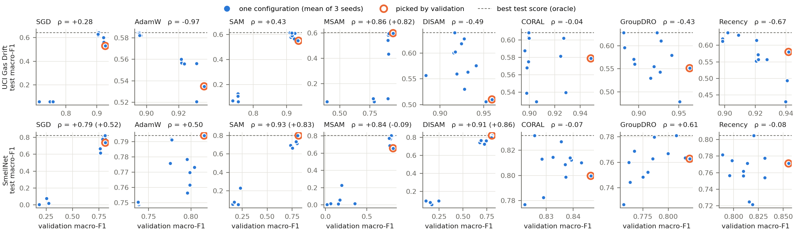
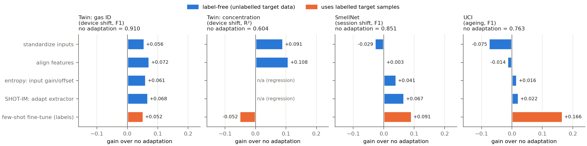
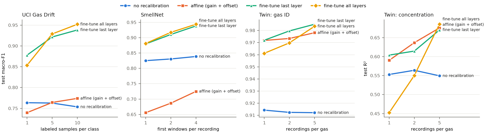

# Does Flatness Help Gas Sensors Survive Drift?

**A leakage-free benchmark of sharpness-aware, domain-generalization and test-time adaptation methods under real electronic-nose drift**

CSL7620 Machine Learning course project, IIT Jodhpur, November 2026
Report (CVPR format, 8 pages): [`reports/final_report_cvpr.pdf`](reports/final_report_cvpr.pdf)

| Member | Roll no. | Part of the project |
|---|---|---|
| Rahul Bhikundia | M26CSA006 | Setup, UCI + SmellNet data and audits, SAM / MSAM / SA-MSAM, tuning protocol, main test runs and statistics, report |
| Gourav | M26CSE018 | Domain-generalization baselines (SAGM, DISAM, CORAL, GroupDRO, CC-PCA, SWA, RF), Twin dataset, model-selection study |
| Jharendra Jogi | M26MAC005 | Shift diagnosis, few-shot recalibration, label-free test-time adaptation, ablations, checkpoints |

---

## Contents

1. [Summary](#summary)
2. [Motivation](#motivation)
3. [Datasets and leakage audit](#datasets-and-leakage-audit)
4. [Methods](#methods)
5. [Protocol](#protocol)
6. [Results](#results)
7. [Where every number comes from](#where-every-number-comes-from)
8. [Repository layout](#repository-layout)
9. [Reproducing](#reproducing)
10. [Checkpoints](#checkpoints)
11. [Reproducibility statement](#reproducibility-statement)
12. [Limitations](#limitations)
13. [References](#references)

---

## Summary

Metal-oxide gas sensors drift: they age, and two copies of the same device never respond identically, so a classifier trained on yesterday's data degrades tomorrow. Flat minima, found by sharpness-aware minimization (SAM) and its cheap variant Momentum-SAM (MSAM), are often claimed to generalize better under distribution shift. **We test that claim** on three public datasets covering three drift types, comparing about 20 methods under one frozen protocol: equal tuning budget, selection on validation only, a single test pass with 5–10 seeds, and statistics over held-out domains (about 7,200 trained models).

**Main findings**

1. **No sharpness-aware or domain-generalization method reliably beats AdamW.** Gains are small and dataset-specific; with 5–9 held-out domains no pairwise difference survives multiple-testing correction.
2. **MSAM is as cheap as SGD but unstable.** It needs half the passes of SAM, yet collapses on SmellNet and Twin at its validation-selected learning rate.
3. **Our drift-aware variant SA-MSAM does not beat a random-direction control** (a pre-registered negative result).
4. **Validation-based model selection is unreliable under drift.** On UCI, validation and test rankings are slightly opposed (Spearman −0.13).
5. **What helps depends on the drift type.** An oracle-calibration diagnosis shows device shift is a per-sensor gain/offset error, and label-free test-time adaptation fixes it (Twin 0.910 → 0.982 macro-F1) and most of session shift (SmellNet 0.851 → 0.918). Ageing is different: only a few labelled samples from the new period help (UCI 0.763 → 0.929; best label-free 0.784).

**Hypotheses from the project brief**

| | Hypothesis | Verdict |
|---|---|---|
| H1 | MSAM matches SAM's robustness | Mixed: MSAM ≥ SAM on UCI, collapses on SmellNet and Twin |
| H2 | MSAM is cheaper than SAM | Supported: same passes as SGD, about half SAM's time |
| H3 | Rankings differ between random and temporal splits | Strongly supported (random splits leak, see audit) |
| H4 | Benefits vary across batches/domains | Supported |

## Motivation

An electronic nose is an array of chemical sensors whose joint response is a fingerprint of a gas. Over weeks and months the sensors' baselines and sensitivities change (ageing, poisoning, humidity and temperature effects), and manufacturing tolerances make every unit respond slightly differently. Recalibrating with reference gases is expensive, so a training method that made models robust to drift "for free" would be valuable. MSAM promises SAM's flatness at no extra cost; if flatness bought drift robustness, MSAM would be that free fix. Earlier e-nose results are, however, often inflated by temporally confounded random splits, so the claim needs a careful protocol.

## Datasets and leakage audit

| | UCI Gas Sensor Array Drift | SmellNet-Base | UCI Twin Gas Sensor Arrays |
|---|---|---|---|
| Source | UCI #224 (Vergara et al., 2012) | Hugging Face `DeweiFeng/SmellNet` (Feng et al., 2025) | UCI #361 (Fonollosa et al., 2016) |
| Drift | sensor ageing, 36 months | session to session (days) | device to device (units) |
| Domains | 10 batches | 6 sessions | 5 units |
| Input | 128 features | 100 × 6 sensor window | 64 features (8 per sensor, extracted by us) |
| Task | 6 gases | 50 substances | 4 gases / log-concentration |
| Metric | macro-F1 | macro-F1 | macro-F1 / R² |
| Test splits | train 1–5 → test 6–10, plus 8 rolling splits | leave one session out | leave one unit out |
| Tuning split | train 1–3 / val 4–5 | train 1–4 / val 5 | train units 1–3 / val 4 |
| Model | MLP (67k params) | 1-D CNN (35k params) | MLP (50k params) |

**Random splits leak heavily**, so all results use domain-held-out splits with scalers fitted on training domains only:

| Dataset | Random split | Held-out domain |
|---|---|---|
| UCI | 99.4% accuracy | 47–77% (train past, test future) |
| SmellNet | 99.9% (overlapping windows on both sides) | ≈82% on an unseen session |
| Twin concentration | R² 0.81–0.94 | negative on some unseen units |

Audit scripts: `scripts/data/audit_*.py`; findings: `notes/audit_findings.md`; plots: `figures/audit_*.png`. Dataset sources, versions, checksums and the two ordering assumptions (SmellNet session order, Twin repetition order) are in [`data/README.md`](data/README.md).

## Methods

| Family | Methods | Code |
|---|---|---|
| Baseline optimizers | SGD (momentum), AdamW | `src/optim.py` |
| Sharpness-aware | SAM, MSAM, SAGM, DISAM | `src/optim.py` |
| Ours | SA-MSAM: MSAM perturbed along a drift direction from per-domain gradient EMAs (variants: disagreement, extrapolated; random-direction control) | `src/optim.py` (`SAMSAM`) |
| Drift-aware training | recency weighting (RIDER-style), gradient interpolation (GI, time-conditioned model trained to extrapolate forward) | `src/train.py` |
| Domain generalization | CORAL, GroupDRO, ERM with mixed-domain batches, drift augmentation, CC-PCA (remove class-conditional drift directions), SWA | `src/train.py` |
| Transductive | per-domain normalization (uses unlabelled test inputs) | `src/train.py` |
| Classical | random forest on the same features | `scripts/experiments/baseline_rf.py` |
| Few-shot (labelled target) | affine recalibration, fine-tune last layer, fine-tune all layers, with k labelled samples | `scripts/experiments/run_fewshot.py` |
| Label-free TTA | input standardization, feature alignment, entropy-minimizing input affine (IM loss), SHOT-style IM feature adaptation | `scripts/experiments/run_tta.py` |
| Diagnosis | oracle per-feature offset and gain+offset correction (uses labels; diagnostic upper bound) | `scripts/experiments/shift_diagnosis.py` |
| Ablations | GRU on raw SmellNet windows, MLP on 30 summary features, TTA hyperparameter sensitivity | `scripts/experiments/run_smellfeat.py`, `tta_sensitivity.py` |

Our MSAM is written from the paper and verified to match the official implementation's iterates (`tests/test_optim.py`).

## Protocol

- **Equal tuning budget:** 12 configurations × 3 seeds per method, scored on the validation split only.
- **Frozen selection:** the chosen configuration and epoch budget are written to `results/tuning/selected_*.json` before any test run (dated in `notes/decisions.md`).
- **One test pass:** 5 seeds (UCI, SmellNet) or 10 seeds (Twin), every held-out domain reported.
- **Statistics:** the held-out split is the unit of analysis; 95% bootstrap CIs over splits, number of splits won, Wilcoxon signed-rank tests with Holm correction, Friedman tests.
- **Transductive methods** (per-domain normalization, TTA) are labelled as such; oracle maps are diagnostics only.

## Results

### Main comparison (mean test score over held-out splits and seeds)

| Method | UCI F1 | SmellNet F1 | Twin gas F1 | Twin conc. R² |
|---|---|---|---|---|
| AdamW (reference) | .764 | .810 | .913 | .554 |
| SAM | .759 | .822 | .932 | .234 |
| MSAM | .781 | .704 | .652 | .470 |
| SA-MSAM (disagreement) | .736 | .826 | .659 | .418 |
| SA-MSAM (random control) | .759 | .835 | .679 | .457 |
| SAGM | .766 | .820 | .946 | .472 |
| DISAM | .689 | .820 | .922 | .563 |
| CORAL | .763 | .853 | .942 | .585 |
| Per-domain normalization\* | .772 | .806 | .977 | .779 |
| CC-PCA | .813 | .745 | .904 | .473 |
| SWA (full) | .763 | .841 | .917 | .394 |
| Random forest | .729 | .874 | .960 | .680 |

\* transductive (uses unlabelled test inputs).



*Test score minus AdamW. Dot: mean over held-out splits; line: 95% bootstrap CI; filled: CI excludes zero; right column: splits where the method beat AdamW.*

### Training cost (forward/backward passes / milliseconds per epoch)

| | UCI | SmellNet | Twin gas | Twin conc. |
|---|---|---|---|---|
| SGD | 59 / 114 | 45 / 137 | 10 / 29 | 10 / 28 |
| AdamW | 59 / 126 | 45 / 137 | 10 / 28 | 10 / 31 |
| MSAM | 59 / 176 | 45 / 143 | 10 / 29 | 10 / 36 |
| SAM | 118 / 358 | 90 / 291 | 20 / 46 | 20 / 52 |
| SAGM | 118 / 256 | 90 / 279 | 20 / 54 | 20 / 60 |
| DISAM | 114 / 381 | 84 / 360 | 16 / 71 | 16 / 78 |

### Model selection under drift



### What kind of drift is it? (oracle calibration diagnosis)

| Dataset | None | Standardize (label-free) | Oracle offset | Oracle gain+offset |
|---|---|---|---|---|
| Twin gas (F1) | .911 | .965 | .952 | **.993** |
| Twin conc. (R²) | .576 | .692 | .501 | **.713** |
| UCI (F1) | .759 | .694 | .785 | .693 |
| SmellNet (F1) | .836 | .802 | .796 | .796 |

Device shift is almost entirely a per-sensor scale and offset error; ageing is not (even the oracle does not help), so the response pattern itself changes.

### Label-free adaptation vs few-shot fine-tuning

| Dataset (drift) | None | Best label-free | Few-shot | Splits won by label-free |
|---|---|---|---|---|
| Twin gas (device) | .910 | **.982** (feature alignment) | .962 | 3/5 (other 2 at ceiling) |
| Twin conc. (device) | .604 | **.712** (feature alignment) | .552 | 4/5 |
| SmellNet (session) | .851 | .918 (SHOT-IM) | **.943** | 6/6 |
| UCI (ageing) | .763 | .784 (SHOT-IM) | **.929** | 5/9 |





### Ablations

- **Architecture barely matters on SmellNet:** CNN 0.810, GRU 0.820, MLP on 30 summary features 0.842, random forest 0.874 (macro-F1). The ranking of methods is unchanged.
- **TTA sensitivity (validation only):** SHOT-IM on SmellNet gains +0.09 to +0.11 for learning rates 1e-4 to 1e-3 and only hurts at 1e-2; on UCI every configuration hurts; Twin is saturated.
- **Seeds:** the TTA conclusions are the same with 3 and 5 seeds.

## Where every number comes from

| Report item | Produced by | Data |
|---|---|---|
| Main table, Fig. 1 | `scripts/analysis/analyze_final.py`, `scripts/figures/fig_main.py` | `results/final/`, `results/analysis/table_test_f1_*.csv` |
| Statistics (CIs, Wilcoxon + Holm, Friedman) | `scripts/analysis/stats_tests.py` | `results/analysis/stats_*` |
| Cost table | `scripts/analysis/analyze_final.py` | timing fields in `results/final/**.json` |
| Selection study, Fig. 2 | `scripts/experiments/run_selection_study.py`, `scripts/analysis/analyze_selection.py` | `results/selection/`, `results/analysis/selection_*` |
| Shift diagnosis | `scripts/experiments/shift_diagnosis.py` | `results/analysis/shift_diagnosis.csv` |
| Few-shot, Fig. 4 | `scripts/experiments/run_fewshot.py`, `scripts/figures/fig_fewshot.py` | `results/fewshot/` |
| TTA, Fig. 3 | `scripts/experiments/run_tta.py`, `scripts/figures/fig_tta.py` | `results/tta/` (`report_final.txt`) |
| Ablations | `scripts/experiments/run_smellfeat.py`, `scripts/analysis/compare_smellfeat.py`, `scripts/experiments/tta_sensitivity.py` | `results/final/smellfeat`, `smellgru`, `results/analysis/tta_sensitivity.csv` |
| Re-training check, commit table | `scripts/experiments/export_checkpoints.py`, `scripts/report/make_repro_tex.py` | `checkpoints/manifest.csv`, `git log` |
| Frozen hyperparameters | `scripts/experiments/select_hp.py` | `results/tuning/selected_*.json` |

## Repository layout

```
src/                     library code
  data_uci.py, data_smellnet.py, data_twin.py   loaders + features (one scaler fit on training domains only)
  models.py              MLP (UCI, Twin), 1-D CNN and GRU (SmellNet)
  optim.py               SAM, MSAM, SA-MSAM, SAGM, DISAM
  sharpness.py           sharpness measures
  train.py               one training run -> one JSON file (the unit everything else builds on)
scripts/
  data/                  download_data.py (fetch + checksum), leakage audits (audit_*.py)
  experiments/           tuning grid, HP selection, frozen test runs, selection study, few-shot, TTA, GRU/feature
                         ablation, shift diagnosis, export_checkpoints.py
  analysis/              tables, bootstrap CIs, Wilcoxon + Holm, Friedman
  figures/               the four report figures
  report/                make_repro_tex.py: commit and re-training tables of the report
  orchestration/         Windows launchers used for the long unattended runs (restart-safe chains)
tests/                   test_optim.py: our MSAM matches the official implementation step by step
results/                 every run as JSON (tuning/, final/, selection/, fewshot/, tta/, ...), analysis/ tables, logs
checkpoints/             seed-0 weights of SGD/AdamW/SAM/MSAM for every split + manifest.csv
figures/                 report figures (PDF + PNG) and audit plots
notes/                   decisions.md (dated decisions, pre-registrations), progress_log.md, audit_findings.md
reports/                 final_report_cvpr.pdf (the report), cvpr/ (LaTeX source)
data/README.md           dataset sources, versions, checksums, assumptions
environment.yml          conda environment;  requirements.txt (ranges)  /  requirements.lock.txt (exact versions used)
```

Each training run is one call of `src/train.py` and writes one JSON file with its arguments, seed, library versions, GPU, timing, learning curve, per-domain metrics and test predictions. Everything else (tables, statistics, figures) reads these files.

## Reproducing

### 1. Environment

Tested on Windows 11, Python 3.12.8, PyTorch 2.5.1 + CUDA 12.1, one NVIDIA GTX 1650 (4 GB). Every run also works on CPU (slower).

```bash
conda env create -f environment.yml && conda activate enose-drift
# or: python -m venv .venv && .venv/Scripts/pip install -r requirements.lock.txt
```

### 2. Data

The datasets are not in the repository (about 3 GB). All three are public; the script downloads them and checks the SHA-256 checksums listed in `data/README.md`.

```bash
python scripts/data/download_data.py
python scripts/data/audit_uci.py; python scripts/data/audit_smellnet.py; python scripts/data/audit_twin.py   # leakage audits
```

### 3. Quick check (about 15 minutes)

```bash
# one training run: MSAM on UCI with its frozen hyperparameters
python -m src.train --dataset uci --split main --opt msam --hp '{"lr":0.03,"rho":1.0}' --epochs 24 --seed 0 --out run.json
# reload the shipped checkpoints and re-score them on the test splits
python scripts/experiments/export_checkpoints.py --load
# our MSAM vs the official implementation
git clone https://github.com/MarlonBecker/MSAM external/msam_code && python -m pytest tests
```

`src.train` options: `--dataset {uci,smell,twin,twinreg,smellfeat,smellgru}`, `--split` (e.g. `main`, `roll3`, `loso2`, `louo4`, `tune`), `--opt {sgd,adamw,sam,msam,samsam_disagree,samsam_extrap,samsam_random,sagm,disam}`, `--method {erm,recency,gi,coral,groupdro,driftaug,swa}`, `--norm {train,domain,ccpca}`, `--sampler {domain,mixed}`, `--hp` / `--mhp` (JSON), `--seed`, `--epochs`, `--sharpness`.

### 4. Full pipeline (about 18 GPU-hours of training, 7,194 runs)

The tables and figures can be rebuilt from the shipped `results/` without retraining (step 5).

```bash
python scripts/experiments/run_grid.py --stage 1          # tuning: 12 configs x 3 seeds per method, validation only (stages 1-4)
python scripts/experiments/select_hp.py --stage 1         # freeze selections -> results/tuning/selected_stage*.json
python scripts/experiments/run_final.py                   # frozen test runs, 5 seeds (UCI, SmellNet)
python scripts/experiments/run_twin.py --phase tune; python scripts/experiments/run_twin.py --phase tune2   # Twin: tune
python scripts/experiments/run_final.py --datasets twin twinreg --seeds 0 1 2 3 4 5 6 7 8 9                 # Twin: 10 seeds
python scripts/experiments/baseline_rf.py
python scripts/experiments/run_selection_study.py
python scripts/experiments/run_fewshot.py --mode tune; python scripts/experiments/run_fewshot.py --mode final
python scripts/experiments/shift_diagnosis.py
python scripts/experiments/run_tta.py --mode tune; python scripts/experiments/run_tta.py --mode select
python scripts/experiments/run_tta.py --mode final --seeds 0 1 2 3 4; python scripts/experiments/run_tta.py --mode report
python scripts/experiments/run_smellfeat.py smellfeat; python scripts/experiments/run_smellfeat.py smellgru
python scripts/experiments/tta_sensitivity.py
```

The exact order and arguments used for the reported runs are in `scripts/orchestration/after_*.cmd` and `notes/progress_log.md`. Finished runs are skipped on restart.

### 5. Tables, statistics, figures, report

```bash
python scripts/analysis/analyze_final.py; python scripts/analysis/stats_tests.py; python scripts/analysis/analyze_selection.py
python scripts/analysis/compare_smellfeat.py
python scripts/figures/fig_main.py; python scripts/figures/fig_fewshot.py; python scripts/figures/fig_tta.py
python scripts/report/make_repro_tex.py
cd reports/cvpr && pdflatex main && bibtex main && pdflatex main && pdflatex main
```

## Checkpoints

`checkpoints/<dataset>/<split>/<opt>_s0.pt` holds the weights of the seed-0 model of SGD, AdamW, SAM and MSAM for every held-out split (97 files; 3 original runs diverged; about 20 MB in total, small enough to keep in the repository, so no external hosting is needed). Each file stores the `state_dict` and the exact arguments; `checkpoints/manifest.csv` lists size, SHA-256 prefix, the score in the report and the score of the re-trained checkpoint.

```python
import torch
from src.models import build_model
ck = torch.load("checkpoints/uci/main/msam_s0.pt")
model = build_model("uci"); model.load_state_dict(ck["state_dict"]); print(ck["args"])
```

Every other model in the study is small (35k to 67k parameters, seconds to minutes to train) and is fully specified by its JSON in `results/`, so it can be re-trained with the one-line command above instead of being stored.

## Reproducibility statement

- **Protocol.** Every method gets the same tuning budget (12 configurations × 3 seeds) scored on validation data only. Selections are frozen in `results/tuning/selected_*.json` before any test run; each method is then tested once with 5 seeds (10 on Twin). Statistics treat the held-out split as the unit of analysis. Scalers are fit on training domains only; methods that use unlabelled target data are labelled transductive.
- **Artifacts.** Every training run (7,194) is stored as a JSON with its arguments, seed, versions, GPU, timing, learning curve, per-domain metrics and test predictions. All tables and figures are regenerated from these files.
- **Determinism.** Seeds are fixed for PyTorch and NumPy; cuDNN kernels are not forced to be deterministic. Re-training the 97 checkpointed runs (`checkpoints/manifest.csv`) reproduces all 73 MLP runs (UCI, Twin) exactly. The SmellNet CNN differs by a median of 0.018 macro-F1, below the seed-to-seed spread, and one MSAM run collapsed on re-training (0.733 to 0.187), the instability the report describes. Claims are therefore made over seeds and splits, never from a single run.
- **Data.** Public datasets with pinned versions and checksums (`data/README.md`). Two ordering assumptions (SmellNet session order, Twin repetition order) are stated there and in the report.
- **Declaration.** We declare that all results in the report were produced by the code in this repository, on the data described above, with the protocol described above, and that no test-set result was used to choose a method, a hyperparameter or an epoch count.

## Limitations

- Few held-out domains (5–9 per dataset) limit statistical power; the selection study uses one test split per dataset.
- Some baselines (random forest, full-length SWA) were added after early test results were seen; this is disclosed and they received the same tuning budget.
- Per-domain normalization and TTA are transductive (they use unlabelled test inputs).
- The UCI release lacks the pre-exposure baseline needed to rule out the confound described by Dennler et al. (2022); SmellNet's session order is assumed chronological.
- Only small models were used, and prior e-nose TTA methods were not re-implemented.

## References

- P. Foret et al. Sharpness-Aware Minimization for Efficiently Improving Generalization. ICLR 2021.
- M. Becker, F. Altrock, B. Risse. Momentum-SAM: Sharpness Aware Minimization without Computational Overhead. arXiv:2401.12033, 2024.
- P. Wang et al. Sharpness-Aware Gradient Matching for Domain Generalization. CVPR 2023.
- R. Zhang et al. Domain-Inspired Sharpness-Aware Minimization Under Domain Shifts. ICLR 2024.
- B. Sun, K. Saenko. Deep CORAL. ECCV Workshops 2016. · S. Sagawa et al. GroupDRO. ICLR 2020. · P. Izmailov et al. SWA. UAI 2018.
- D. Wang et al. Tent. ICLR 2021. · J. Liang, D. Hu, J. Feng. SHOT. ICML 2020.
- A. Vergara et al. Chemical gas sensor drift compensation using classifier ensembles. Sens. Actuators B 166, 2012.
- J. Fonollosa et al. Calibration transfer and drift counteraction in chemical sensor arrays using direct standardization. Sens. Actuators B 236, 2016.
- D. Feng et al. SmellNet: A Large-scale Dataset for Real-world Smell Recognition. arXiv:2506.00239, 2025.
- N. Dennler et al. Drift in a popular metal oxide sensor dataset reveals limitations for gas classification benchmarks. Sens. Actuators B 361, 2022.

The full bibliography is in [`reports/cvpr/main.bib`](reports/cvpr/main.bib).
